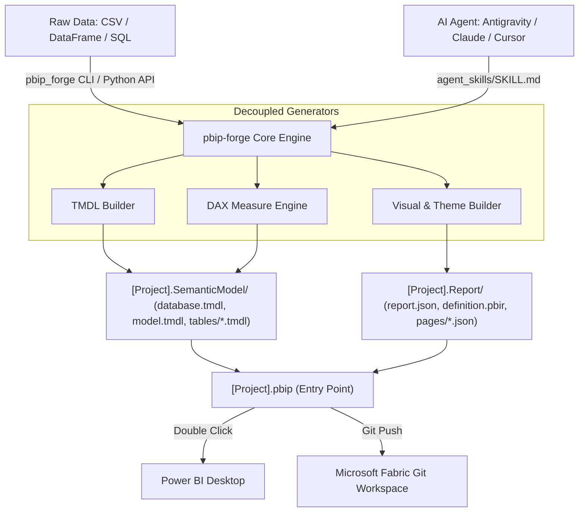

<div align="center">

**English** · [Español](docs/readme/README_es.md)

# PBIP-Forge: Programmatic Power BI & Fabric Generator

### Generate 100% valid Power BI Developer Mode (`.pbip`) projects, TMDL semantic models, and visual reports directly from code or AI Agents.

**Automate BI development from raw datasets to production-ready dashboards.**

[](https://www.python.org/)
[](https://powerbi.microsoft.com/)
[](https://learn.microsoft.com/en-us/fabric/cicd/git-integration/intro-to-git-integration)
[](LICENSE)
[](agent_skills/SKILL.md)

<br />


<br /><br />

**[Quick Start](#quick-start) · [How It Works](#how-it-works) · [Feature Matrix](#feature-matrix) · [CLI Usage](#cli-usage) · [AI Agent Integration](#ai-agent-integration)**

<code>pip install git+https://github.com/dev-yisus/pbip-forge.git</code>

</div>

---

> [!IMPORTANT]
> `pbip-forge` leverages Microsoft's official **Power BI Developer Mode (`.pbip`)** and the declarative **Tabular Model Definition Language (TMDL)** to enable atomic semantic model creation without launching Power BI Desktop. Generated repositories are 100% compatible with **Microsoft Fabric Git Integration** and CI/CD deployment pipelines.

---

## Why pbip-forge?

Historically, crafting a Power BI report demanded hours of manual interaction in the desktop UI: importing files, configuring data types, typing repetitive DAX formulas, and pixel-positioning cards and charts.

`pbip-forge` reverses this workflow through **reverse-engineering of the PBIP format**:
1. Ingests structured datasets (CSV, Pandas DataFrames, JSON, or SQL queries).
2. Infers tabular schemas, data types, and crafts Power Query M partition scripts.
3. Automatically writes standard DAX measures (SUM, AVERAGE, DISTINCTCOUNT, margin ratios with DIVIDE, Time Intelligence).
4. Assembles interactive reports styled with the executive **Microsoft Fluent 2** palette.
5. Emits a Git-friendly folder hierarchy that opens instantly upon double-clicking the `.pbip` file.

---

## Feature Matrix

| Capability | Power BI Desktop (Manual) | Tabular Editor 2/3 | pbip-forge |
| :--- | :--- | :--- | :--- |
| **Headless Programmatic Generation** | [GUI Required](https://learn.microsoft.com/en-us/power-bi/create-reports/desktop-dimensional-model-report) | [C# Scripts Only](https://tabulareditor.com/) | [Native Python & CLI](#cli-usage) |
| **Visual Report Generation (`.Report`)** | Manual Canvas Interaction | [Model Only](https://docs.tabulareditor.com/) | [Full JSON Pages & Visuals](#python-api-usage) |
| **Autonomous AI Agent Execution** | [Unsupported](agent_skills/SKILL.md) | [Limited Scripting](agent_skills/SKILL.md) | [Official Agent Skill Included](agent_skills/SKILL.md) |
| **Fabric Git & CI/CD Native** | Manual Export | Manual Deploy | [Native Fabric Git Workflow](https://learn.microsoft.com/en-us/fabric/cicd/git-integration/intro-to-git-integration) |
| **Open Source Licensing** | Proprietary | Commercial | [100% Free MIT](LICENSE) |

---

## How It Works



---

## Quick Start

### 1. Installation

```bash
git clone https://github.com/dev-yisus/pbip-forge.git
cd pbip-forge
pip install -r requirements.txt
pip install -e .
```

### 2. CLI Usage

Convert any CSV file into a complete Power BI dashboard with a single command:

```bash
python -m pbip_forge build --csv examples/sample_superstore.csv --name "SuperStore_Executive" --out ./output
```

The tool compiles the complete project structure:
```
output/
└── SuperStore_Executive/
    ├── SuperStore_Executive.pbip
    ├── SuperStore_Executive.Report/
    │   ├── .platform
    │   ├── definition.pbir
    │   └── definition/
    │       ├── report.json
    │       └── pages/
    └── SuperStore_Executive.SemanticModel/
        ├── .platform
        ├── definition.pbism
        └── definition/
            ├── database.tmdl
            ├── model.tmdl
            └── tables/
                └── Ventas.tmdl
```

---

## Python API Usage

```python
from pbip_forge import (
    PBIPGenerator,
    PBIPProject,
    TableDefinition,
    ColumnDefinition,
    PageDefinition,
    VisualDefinition,
    DataType,
    DAXEngine,
)

# 1. Define columns and DAX measures
columns = [
    ColumnDefinition("OrderID", DataType.INT64),
    ColumnDefinition("Amount", DataType.DECIMAL, format_string="$#,0.00"),
    ColumnDefinition("Region", DataType.STRING),
]

measures = [
    DAXEngine.sum_measure("Sales", "Amount", "Total Revenue", is_currency=True),
    DAXEngine.count_measure("Sales", "OrderID", "Total Orders"),
]

# 2. Configure table
table = TableDefinition(name="Sales", columns=columns, measures=measures)

# 3. Define page and interactive visuals
visuals = [
    VisualDefinition("Revenue KPI", "card", x=20, y=20, width=280, height=130),
    VisualDefinition("Revenue by Region", "clusteredColumnChart", x=20, y=170, width=580, height=320),
]
page = PageDefinition(name="ExecutiveSummary", display_name="Executive Summary", visuals=visuals)

# 4. Build the PBIP project
project = PBIPProject(name="MyDashboard", tables=[table], pages=[page])
generator = PBIPGenerator(project, output_dir="./my_reports")
generator.build()
```

---

## AI Agent Integration

If you use autonomous coding agents such as Antigravity, Claude Code, Cursor, or ChatGPT, you can point them directly to:
[`agent_skills/SKILL.md`](agent_skills/SKILL.md)

The agent will autonomously synthesize relational star/snowflake schemas, optimized DAX formulas, and visual coordinate layouts adhering to official Microsoft Fabric standards.

---

## Unit Testing

```bash
python -m unittest discover tests
```

---

## License

Distributed under the MIT License. See [LICENSE](LICENSE) for details.

**Author:** [Jesús Serrano Mori (dev-yisus)](https://github.com/dev-yisus)
