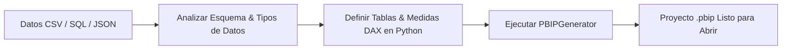

# 🤖 PBIP-Forge Agent Skill: Generación Programática de Power BI

Esta habilidad permite a cualquier Agente de IA (Claude, Antigravity, Cursor, ChatGPT, AutoGen) crear, modificar y desplegar proyectos completos y funcionales de **Microsoft Power BI** en el nuevo formato estándar para desarrolladores **PBIP** y **TMDL** (*Tabular Model Definition Language*), sin requerir interacción manual con la interfaz gráfica de Power BI Desktop.

---

## 🎯 Capacidades del Agente

Cuando un usuario solicite:
- *"Créame un dashboard de Power BI para estos datos..."*
- *"Convierte este archivo CSV en un proyecto PBIP con esquema en estrella y medidas DAX..."*
- *"Genera un modelo semántico en TMDL con medidas de crecimiento YoY..."*

El Agente de IA ejecutará el siguiente flujo de trabajo:



---

## 🛠️ Especificación Técnica del Formato PBIP

Un proyecto `.pbip` válido de Microsoft Fabric consta de la siguiente estructura obligatoria:

1. **`NombreProyecto.pbip`:** Archivo JSON raíz con la versión y referencia al reporte.
2. **`NombreProyecto.Report/`:**
   - `.platform`: Metadatos de integración Git en Microsoft Fabric (schema 2.0.0).
   - `definition.pbir`: Apuntador relativo hacia el modelo semántico (`../NombreProyecto.SemanticModel`).
   - `definition/report.json`: Configuración del reporte y enlace al tema base.
   - `definition/pages/pages.json`: Metadatos y orden de las páginas.
   - `definition/pages/<page_id>/page.json`: Layout visual con coordenadas X, Y, ancho y alto.
   - `StaticResources/SharedResources/BaseThemes/Fluent2-CY26SU08.json`: Paleta de colores corporativa.
3. **`NombreProyecto.SemanticModel/`:**
   - `.platform`: Metadatos del modelo semántico (schema 2.0.0).
   - `definition.pbism`: Configuración de compatibilidad (versión 4.2).
   - `definition/database.tmdl`: compatibilityLevel 1600.
   - `definition/model.tmdl`: Cultura (`es-ES`), fuentes y directivas `ref table`.
   - `definition/relationships.tmdl`: Relaciones manyToOne con `crossFilteringBehavior`.
   - `definition/tables/*.tmdl`: Definición de columnas, tipos de datos, partición M y medidas DAX.

---

## 🐍 Código de Ejemplo para Agentes

El Agente puede utilizar la API de `pbip_forge` directamente en un script de Python:

```python
from pbip_forge import (
    PBIPGenerator,
    PBIPProject,
    TableDefinition,
    ColumnDefinition,
    DataType,
    AggregationType,
    PageDefinition,
    VisualDefinition,
)
from pbip_forge.dax_engine import DAXEngine

# 1. Definir columnas y M-Query
columns = [
    ColumnDefinition("ID_Venta", DataType.INT64, summarize_by=AggregationType.NONE),
    ColumnDefinition("Fecha", DataType.DATETIME, format_string="dd/mm/yyyy"),
    ColumnDefinition("Cliente", DataType.STRING),
    ColumnDefinition("Monto", DataType.DOUBLE, format_string='"$"#,0.00', summarize_by=AggregationType.SUM),
]

# 2. Generar medidas DAX automáticas
measures = [
    DAXEngine.generate_sum_measure("Ventas", "Monto", "Total Ventas", is_currency=True),
    DAXEngine.generate_average_measure("Ventas", "Monto", "Ticket Promedio", is_currency=True),
]

table = TableDefinition(
    name="Ventas",
    m_query='let Source = Csv.Document(File.Contents("datos.csv"), [Delimiter=",", Encoding=65001]) in Source',
    columns=columns,
    measures=measures
)

# 3. Definir visuales
page = PageDefinition(
    name="Overview",
    display_name="Resumen de Ventas",
    visuals=[
        VisualDefinition("KPI Ventas", "card", x=20, y=20, width=280, height=140),
        VisualDefinition("Evolución de Ventas", "lineChart", x=320, y=20, width=900, height=360)
    ]
)

# 4. Generar proyecto completo
project = PBIPProject(name="Analytics_Dashboard", tables=[table], pages=[page])
generator = PBIPGenerator(project, output_dir="./output")
generator.build()
```

---

## ⚡ Atajo Instantáneo desde CSV

Si el usuario simplemente proporciona un archivo CSV:

```python
from pbip_forge import PBIPGenerator

generator = PBIPGenerator.from_csv(
    csv_path="datos_ventas.csv",
    project_name="Dashboard_Ventas_Autogenerado",
    output_dir="./salida"
)
generator.build()
```

Esto inferirá tipos de datos, creará medidas DAX sumatorias automáticas, estructurará el TMDL y montará la página visual lista para abrir con 1 doble clic en **Power BI Desktop**.
