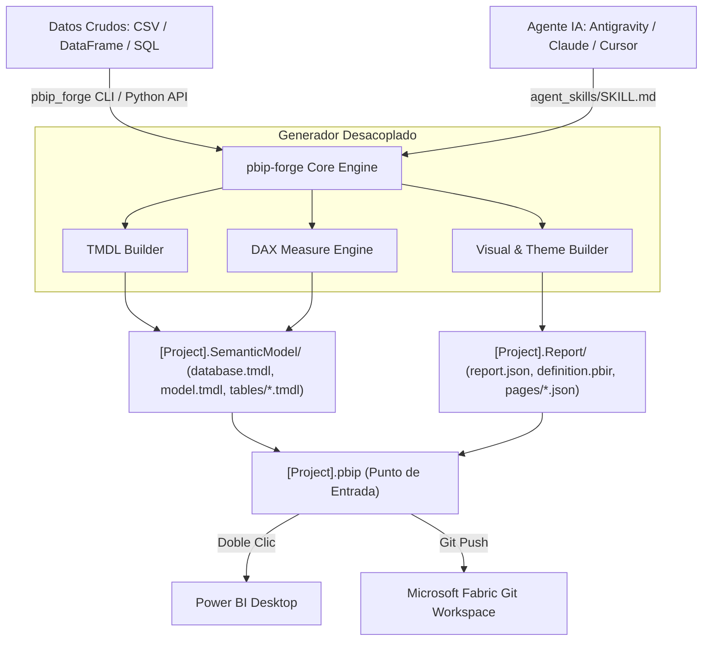

<div align="center">

[English](../../README.md) · **Español**

# PBIP-Forge: Motor Generador de Power BI & Fabric

### Genera proyectos Power BI Developer Mode (`.pbip`), modelos semánticos TMDL y reportes visuales programáticamente desde código o Agentes de IA.

**Automatiza la creación de BI desde datos crudos hasta dashboards listos para producción.**

[](https://www.python.org/)
[](https://powerbi.microsoft.com/)
[](https://learn.microsoft.com/en-us/fabric/cicd/git-integration/intro-to-git-integration)
[](../../LICENSE)
[](../../agent_skills/SKILL.md)

<br />


<br /><br />

**[Inicio Rápido](#inicio-rápido) · [Cómo Funciona](#cómo-funciona) · [Matriz Comparativa](#matriz-comparativa) · [Uso en CLI](#uso-desde-la-terminal) · [Integración con Agentes IA](#agentes-de-ia)**

<code>pip install git+https://github.com/dev-yisus/pbip-forge.git</code>

</div>

---

> [!IMPORTANT]
> `pbip-forge` aprovecha el modo de desarrollo nativo de **Power BI Developer Mode (`.pbip`)** y el lenguaje declarativo **TMDL (Tabular Model Definition Language)** para permitir la creación atómica de modelos semánticos sin necesidad de abrir Power BI Desktop. Los proyectos generados son 100% compatibles con **Microsoft Fabric Git Integration** y pipelines de CI/CD.

---

## Por qué pbip-forge?

Históricamente, construir un dashboard de Power BI requería horas de trabajo manual en la interfaz gráfica: importar datos, definir tipos de datos, redactar medidas DAX una a una y posicionar visuales a mano.

`pbip-forge` invierte esta dinámica mediante **ingeniería inversa del formato PBIP**:
1. Ingiere datos estructurados (CSV, DataFrames de Pandas, JSON o consultas SQL).
2. Deduce esquemas tabulares, tipos de datos y genera particiones Power Query M.
3. Genera automáticamente medidas DAX estándar (SUM, AVERAGE, ratios con DIVIDE, Time Intelligence).
4. Ensambla reportes interactivos con la paleta ejecutiva **Microsoft Fluent 2**.
5. Produce un árbol de carpetas Git-friendly que se abre con doble clic en Power BI Desktop.

---

## Matriz Comparativa

| Capacidad | Power BI Desktop (Manual) | Tabular Editor 2/3 | pbip-forge |
| :--- | :--- | :--- | :--- |
| **Generación Programática Headless** | [Requiere GUI](https://learn.microsoft.com/en-us/power-bi/create-reports/desktop-dimensional-model-report) | [Solo Scripts C#](https://tabulareditor.com/) | [Python y CLI Nativo](#uso-desde-la-terminal) |
| **Generación de Reporte Visual (`.Report`)** | Interacción Manual en Lienzo | [Solo Modelo Semántico](https://docs.tabulareditor.com/) | [Páginas y Visuales JSON Completos](#uso-desde-python) |
| **Compatibilidad con Agentes IA Autónomos** | [No Soportado](../../agent_skills/SKILL.md) | [Scripting Limitado](../../agent_skills/SKILL.md) | [Skill Oficial para Agentes](../../agent_skills/SKILL.md) |
| **Integración Git & Microsoft Fabric** | Exportación Manual | Despliegue Manual | [Flujo Nativo Fabric Git](https://learn.microsoft.com/en-us/fabric/cicd/git-integration/intro-to-git-integration) |
| **Licencia y Costo** | Propietario / Comercial | Comercial de Pago | [100% Gratuito y Libre (MIT)](../../LICENSE) |

---

## Cómo Funciona



---

## Inicio Rápido

### 1. Instalación

```bash
git clone https://github.com/dev-yisus/pbip-forge.git
cd pbip-forge
pip install -r requirements.txt
pip install -e .
```

### 2. Uso desde la Terminal (CLI)

Convierte un dataset CSV en un dashboard completo de Power BI en un solo comando:

```bash
python -m pbip_forge build --csv examples/sample_superstore.csv --name "SuperStore_Executive" --out ./output
```

El proyecto se compilará de inmediato:
```
output/
└── SuperStore_Executive/
    ├── SuperStore_Executive.pbip
    ├── SuperStore_Executive.Report/
    │   ├── .platform
    │   ├── definition.pbir
    │   └── definition/
    │       ├── report.json
    │       └── pages/
    └── SuperStore_Executive.SemanticModel/
        ├── .platform
        ├── definition.pbism
        └── definition/
            ├── database.tmdl
            ├── model.tmdl
            └── tables/
                └── Ventas.tmdl
```

---

## Uso desde Python

```python
from pbip_forge import (
    PBIPGenerator,
    PBIPProject,
    TableDefinition,
    ColumnDefinition,
    PageDefinition,
    VisualDefinition,
    DataType,
    DAXEngine,
)

# 1. Definir columnas y medidas DAX
columnas = [
    ColumnDefinition("ID_Orden", DataType.INT64),
    ColumnDefinition("Monto", DataType.DECIMAL, format_string="$#,0.00"),
    ColumnDefinition("Region", DataType.STRING),
]

medidas = [
    DAXEngine.sum_measure("Ventas", "Monto", "Ingreso Total", is_currency=True),
    DAXEngine.count_measure("Ventas", "ID_Orden", "Total Transacciones"),
]

# 2. Configurar la tabla
tabla = TableDefinition(name="Ventas", columns=columnas, measures=medidas)

# 3. Definir la página y sus visuales interactivos
visuales = [
    VisualDefinition("KPI Ingresos", "card", x=20, y=20, width=280, height=130),
    VisualDefinition("Ingresos por Region", "clusteredColumnChart", x=20, y=170, width=580, height=320),
]
pagina = PageDefinition(name="ResumenEjecutivo", display_name="Resumen Ejecutivo", visuals=visuales)

# 4. Construir el proyecto PBIP
proyecto = PBIPProject(name="MiDashboard", tables=[tabla], pages=[pagina])
generador = PBIPGenerator(proyecto, output_dir="./mis_reportes")
generador.build()
```

---

## Agentes de IA

Si utilizas asistentes como Antigravity, Claude Code, Cursor o ChatGPT, puedes indicarle que lea el archivo:
[`agent_skills/SKILL.md`](../../agent_skills/SKILL.md)

El agente sabrá exactamente cómo construir modelos relacionales (estrella, copo de nieve, multi-hechos), fórmulas DAX optimizadas y layouts visuales siguiendo los estándares oficiales de Microsoft Fabric.

---

## Pruebas Unitarias

```bash
python -m unittest discover tests
```

---

## Licencia

Distribuido bajo la Licencia MIT. Consulta [LICENSE](../../LICENSE) para más detalles.

**Autor:** [Jesús Serrano Mori (dev-yisus)](https://github.com/dev-yisus)
